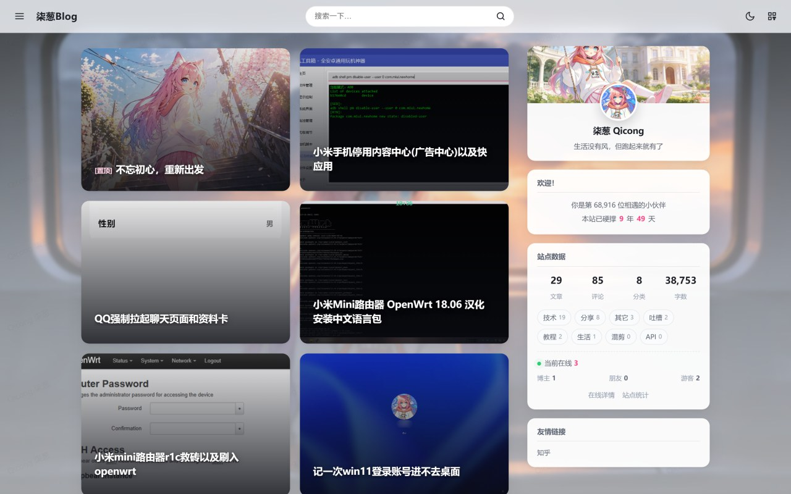
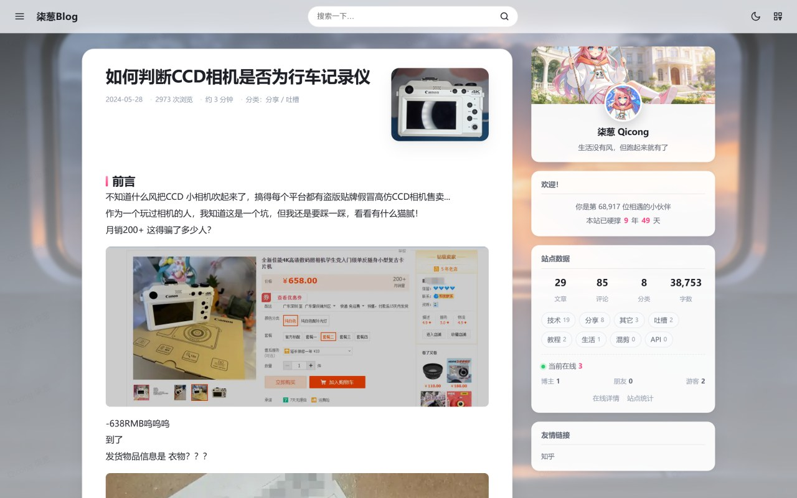
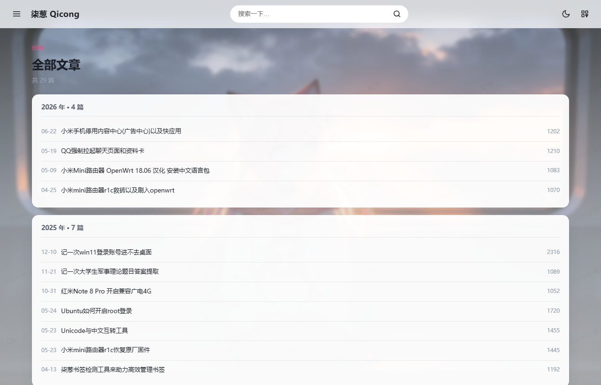
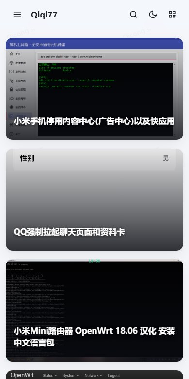
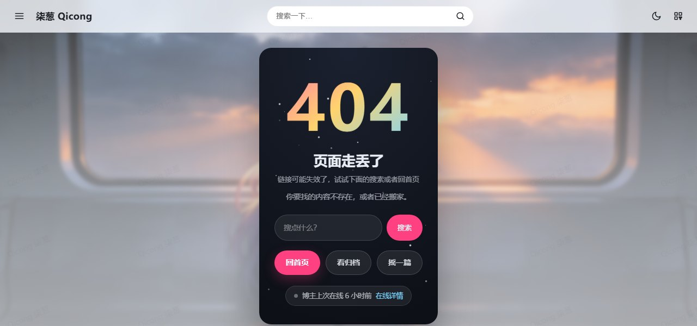

<div align="center">

# qiqi77

**一个给 Typecho 用的卡片式博客主题**

毛玻璃 · 深浅色 · PJAX 无刷新 · 后台可视化配置

[](https://typecho.org)
[](https://www.php.net)
[](LICENSE)
[](../../releases)

[快速开始](#快速开始) · [安装](docs/install.md) · [伪静态](docs/rewrite.md) · [设置](docs/settings.md) · [定制](docs/customize.md) · [FAQ](docs/faq.md)

</div>



---

## 这是什么

qiqi77 是给 [Typecho](https://typecho.org) 写的一套主题。装好之后不用改代码，在后台「设置外观」里就能调颜色、圆角、字号、壁纸、打赏码、社交链接这些。

设计上走的是「内容优先」：卡片承载封面和标题，正文留白充足，背景壁纸只做氛围不抢注意力。深色模式不是简单反色，是另配的一套亮度关系。

后台 **50 多项**可调，分 10 组，带搜索和滑块。拿不准的项保持默认，留空的项会自动回落到默认值。

> 演示站：<https://qicong.zqhope.cn>

---

## 功能

### 布局与视觉

- **卡片式首页**：大图卡与文字卡自动混排，按封面有无切换形态
- **毛玻璃**：顶栏、抽屉、弹窗统一使用 `backdrop-filter`，滚动时层次不乱
- **深浅色**：跟随系统，或按时间段自动切换（默认 19:00–07:00）
- **背景壁纸**：可调可见度、模糊、压暗，桌面与移动端可分别指定
- **主题色**：一处修改，按钮、链接、标签、进度条全部跟随

### 阅读体验

- **PJAX**：站内跳转无刷新，带顶部进度条，浏览器前进后退正常
- **阅读进度**：右下角百分比胶囊，随滚动实时更新
- **自动目录**：按标题层级生成，移动端收进浮动按钮
- **代码块**：高亮 + 一键复制 + 横向滚动，不撑破布局
- **图片**：懒加载 + 点击放大，长文不卡

### 互动

- **评论**：QQ 号快捷填充、多源头像解析、楼中楼、分页
- **搜索**：独立搜索页，无结果时推荐相关文章
- **打赏**：微信 / 支付宝 / QQ 三码弹窗
- **社交**：十种平台的链接，勾选式配置，不用手写 JSON

### 站长向

- **50+ 项后台配置**：分 10 组，左侧导航 + 搜索 + 一键恢复默认
- **配置备份**：一键存/取，存在数据库，换主题不丢
- **动态 sitemap**：`/sitemap.xml` 实时生成，按访问域名输出
- **百度推送**：新文自动推，按每日配额截断，不浪费额度
- **SEO**：结构化数据、Open Graph、canonical、各站验证码
- **自定义代码**：CSS / JS / 页头 / 页脚四个注入位

---

## 截图

| 文章页 | 归档页 |
|---|---|
|  |  |

| 移动端 | 404 |
|---|---|
|  |  |

---

## 环境要求

| 项目 | 要求 | 说明 |
|---|---|---|
| Typecho | **1.2 或更高** | 1.3 已实测 |
| PHP | **8.0 或更高** | 用了构造器属性提升、`match` |
| 数据库 | MySQL 5.7+ / SQLite | 跟随 Typecho |
| 浏览器 | 近两年的版本 | 用了 `color-mix`、`backdrop-filter` |

不需要 Composer，不需要装插件，不需要改数据库表结构。

---

## 快速开始

### 1. 下载

到 [Releases](../../releases) 下载最新版，或点 **Code → Download ZIP**。

解压后把文件夹**改名为 `qiqi77`**。

> 文件夹名必须是 `qiqi77`——主题配置存在 `theme:qiqi77` 这个键下，改名会导致设置读不到。

### 2. 上传

放到 Typecho 的 `usr/themes/` 目录：

```
你的站点/
└── usr/themes/
    └── qiqi77/
        ├── functions.php
        ├── index.php
        └── ...
```

宝塔面板：**文件 → 进入 `usr/themes` → 上传 → 解压**。

### 3. 启用

后台 → **控制面板 → 外观 → 可以使用的外观** → 找到 `qiqi77` → **启用**。

### 4. 配置

后台 → **外观 → 设置外观**。

第一次只改三样就够：

1. **基础信息**：站点副标题、头像地址
2. **外观与配色**：主题色
3. **文案微调**：页面水印文字（不想显示就留空）

其余保持默认，改完点最下面的 **保存设置**。

### 5. 检查

打开首页。样式没生效就 `Ctrl + F5` 强刷——大概率是浏览器缓存了旧 CSS。

完整图文步骤：[安装教程](docs/install.md)

---

## 设置说明

后台设置分 10 组，左侧导航可直接跳转，顶部搜索框按关键词过滤。

| 分组 | 管什么 |
|---|---|
| 基础信息 | 头像、站点图标、微信二维码、版权文案、页脚说明 | 13 |
| 外观与配色 | 主题色、圆角、字体、壁纸、背景可见度、暗色时段 | 14 |
| 首页与卡片 | 卡片高度、封面来源、置顶公告、卡片列数 | 6 |
| 文章页 | 阅读进度、目录、打赏码、代码复制 | 6 |
| 评论 | QQ 快捷填充、头像来源与镜像 | 4 |
| 抽屉与菜单 | 社交链接、自定义菜单、侧栏封面 | 5 |
| 收录与统计 | 百度密钥、发布自动推送、各站验证码、Clarity | 7 |
| 性能与高级 | CDN、图片域名替换、PJAX、分页 | 10 |
| 细节微调 | 底色、字号、行高、宽度、间距、阴影、头像形状 | 12 |
| 文案微调 | 搜索提示、404 文案、水印文字 | 4 |

几个最常调的：

| 想做的事 | 去哪一组 | 调哪项 |
|---|---|---|
| 壁纸太淡看不清 | 外观与配色 | 背景图可见度 → 往 100 |
| 壁纸太抢内容 | 外观与配色 | 背景图可见度 → 往 0，加一点背景模糊 |
| 卡片透出壁纸 | 外观与配色 | 前景不透明度 → 70 左右 |
| 字太小 / 行太挤 | 细节微调 | 正文字号、正文行高 |
| 首页想一屏多看几篇 | 首页与卡片 | 首页每行卡片数 → 3 或 4 |

每一项的完整说明：[设置说明](docs/settings.md)

---

## 目录结构

```
qiqi77/
├── functions.php          # 主题入口：配置注册、钩子
├── index.php              # 首页
├── post.php               # 文章页
├── archive.php            # 归档 / 分类 / 标签
├── page.php               # 独立页面
├── 404.php                # 404
├── tpl-*.php              # 自定义模板（归档、友链、在线、统计）
├── src/                   # PHP 类
│   ├── Options.php        # 配置定义 + 设置页渲染
│   ├── Bootstrap.php      # 初始化、配置迁移
│   ├── View.php           # 视图渲染
│   ├── Content/           # 卡片、正文解析、计数
│   ├── Comment/           # 评论树、头像、UA
│   ├── Site/              # SEO、抽屉、导航、在线状态、百度推送
│   └── Support/           # HTML、URL、字符串、Emoji、HTTP
├── views/
│   ├── chrome/            # head / tail / 抽屉
│   └── partials/          # 侧栏、卡片、评论、搜索头
├── assets/
│   ├── css/               # 9 个源文件 → 合成 app.css
│   ├── js/                # 交互
│   └── images/            # 默认图
└── docs/                  # 文档与截图
```

想改样式，从 `assets/css/tokens.css` 开始——颜色、圆角、间距、字体全在里面。

---

## 性能

演示站在普通虚拟主机上的粗略数字（不含图片）：

| 指标 | 数值 |
|---|---|
| 首页 HTML | ~40 KB |
| CSS（合成后） | ~70 KB |
| JS（全部，已压缩） | ~120 KB |
| 首屏请求数 | 12 个左右 |
| 第三方 PHP 依赖 | 无 |

优化点：图片懒加载、PJAX 减少重复请求、CSS 变量避免重复声明。

---

## 兼容性

| 项 | 支持情况 |
|---|---|
| Typecho 1.3 | 已实测 |
| Typecho 1.2 | 理论支持（未逐版本回归） |
| PHP 8.0 / 8.1 / 8.2 / 8.3 | 支持 |
| PHP 7.4 及以下 | 不支持，会白屏 |
| IE / 旧版 Edge | 不打算支持 |
| iOS Safari 15+ | 支持 |
| 移动端 320px 宽 | 支持 |

---

## 常见问题

**启用后白屏？**
PHP 版本低于 8.0。主题用了 PHP 8 语法。

**样式没变化？**
`Ctrl + F5`。还不行就把「性能与高级 → 静态资源来源」改成 `local`。

**设置保存了但前台没变？**
文件夹名不是 `qiqi77`，配置读不到。改回原名即可。

**打赏按钮不显示？**
三个赞赏码都是空的，填一个就行。

更多：[17 条排错清单](docs/faq.md)

---

## 路线图

- [ ] 文章页目录跟随高亮
- [ ] 图片灯箱换成原生 `<dialog>`
- [ ] 后台设置支持导入/导出 JSON
- [ ] sitemap 文件缓存，减少数据库查询
- [ ] 英文语言包

有想法欢迎提 [Issue](../../issues)。

---

## 贡献

欢迎 PR。提交前请确认：

1. PHP 文件能通过 `php -l`
2. 没有引入新的第三方依赖
3. 改了 CSS 记得重新合成 `app.css`
4. 新配置项在 `docs/settings.md` 补一行

```bash
# 合成 CSS
cd assets/css
cat tokens.css base.css layout.css cards.css sidebar.css \
    post.css pages.css comment.css dark.css > app.css
```

---

## 致谢

- [Typecho](https://typecho.org) — 轻量好用的博客程序
- [MDUI](https://www.mdui.org) — 早期的视觉参考
- [highlight.js](https://highlightjs.org) · [PJAX](https://github.com/MoOx/pjax) · [Lazyload](https://github.com/verlok/vanilla-lazyload) · [tocbot](https://github.com/tscanlin/tocbot)

---

## 许可证

[MIT](LICENSE)。随便改、随便用，保留版权声明即可。

<div align="center">
<br/>
<sub>工具做出来是给自己用的，顺手了再开源。</sub>
</div>
